# 小洛探探 · SpriteLens

**小洛探探**是《洛克王国：世界》的 Windows 本地数据观测工具。把自己的精灵背包、精灵蛋、家园和附近观察整理到同一个窗口里：找双牌、挑亲本、查资料、规划配窝，都可以从已有数据出发。

先打开小洛探探，再登录游戏。采集到的数据会保存在本机；下次打开，可以继续查看背包、蛋仓与家园历史资料，也能离线查阅图鉴。

工具采用被动流量采集，不修改游戏报文、不读写游戏内存、不注入进程。查看与规划不需要 ESP HID 设备。

[主要功能](#主要功能) · [开始使用](#开始使用) · [数据与隐私](#数据与隐私) · [文档索引](#文档索引)

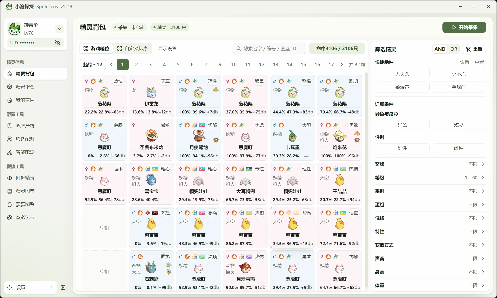


## 主要功能

### 精灵背包：在几千只精灵里找到想要的那只

按游戏箱位查看库存，也可以切到自定义排序，集中比较符合条件的个体。

- **游戏箱位**：按箱号与出战队伍定位，保留空格与筛选后的箱位关系，方便回游戏找精灵。
- **自定义排序**：用卡片比较立绘、系别、六维、天赋阶、性格、体型和声音；按需要调整显示字段。
- **组合筛选**：名称、编号、等级、性别、性格、系别、蛋组、奖牌、特性、异色、炫彩，以及身高、体重、声音等条件；支持 AND / OR 组合，把常用组合保存为快捷条件。
- **个体详情**：查看六维、体型参考范围、声音、奖牌与外观标记、箱位/队伍位置，并顺着进化链、精灵蛋和获取方式继续查资料。

例如，先用“大块头 + 粗嗓门”找双牌，再加性格与蛋组缩小范围，点开个体确认具体数值和所在箱位。搜索进化链中的名称时，也能找到同链成员，减少逐个形态查找。

### 附近精灵与悬浮雷达：边走边看这次观察到了什么

附近页把精灵列表和场景地图放在一起，查看名称、等级、系别、奖牌、身高、体重、声音及其参考范围位置。可以搜索、按有牌优先或距离排序，再结合地图上的自己位置判断观察方向。

- **地图与搜索足迹**：查看已记录的覆盖范围与本次足迹，也可清除本次足迹，方便继续搜索。
- **悬浮雷达**：把地图独立留在游戏旁边，减少来回切换主窗口。
- **双牌提醒音**：发现符合提醒条件的双牌个体时播放提示。

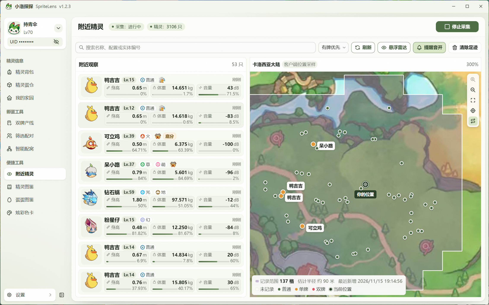

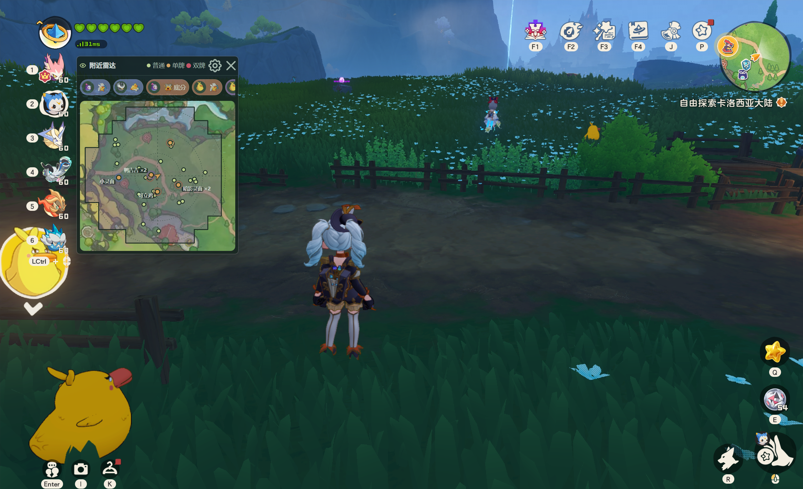

这里只表示本次连接已经观察到的实体，不是全地图透视，也不保证覆盖完整。地图映射、距离和方向仍有待实测校准的场景；搜索覆盖记录也不代表范围内已经没有精灵。

### 精灵图鉴：看种族值，也查进化、分布与相性

按名称、编号、系别或蛋组查资料，卡片列表旁直接展开详情，连续查阅时不用反复进出页面。

详情包括立绘、种族值雷达、特性、性别比例、身高/体重范围、分布、进化条件、属性相性与已收录的 Wiki 补充资料。蛋组支持并集与交集，精灵、精灵蛋和进化成员之间可以互相跳转。

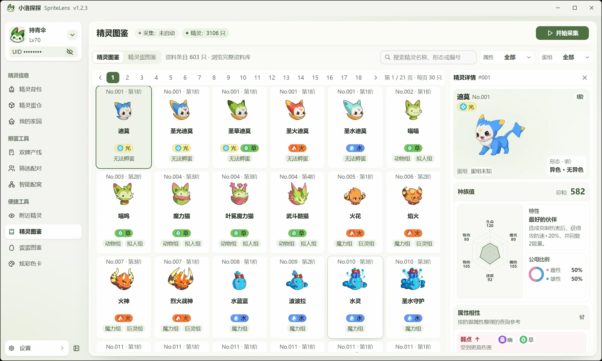

### 蛋图鉴：比较孵化时间，查清对应形态

查找精灵蛋的蛋组、类型、孵化时长、体型范围、性别比例、倍率换算与孵化形态。支持按孵化时长排序，以及双蛋组、同乘等筛选，方便在准备培育前先核对目标蛋的资料。

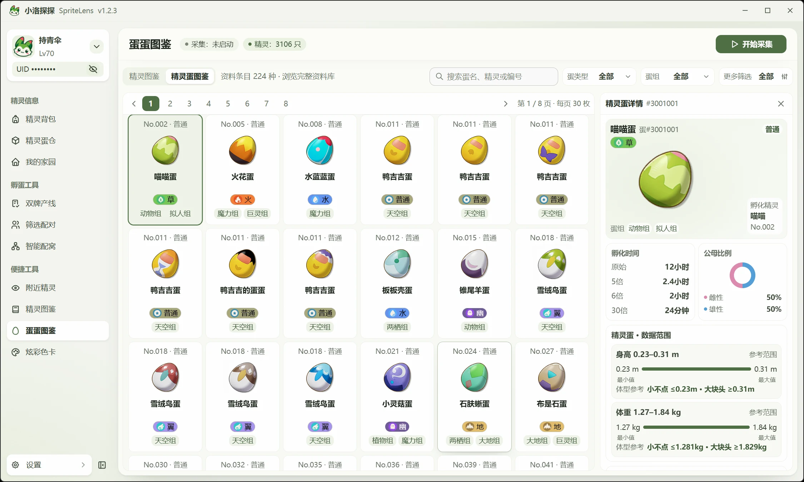

### 精灵蛋仓：除了“有什么蛋”，还知道“从哪里收来的”

采集到的蛋会保存到本地蛋仓。可以按获得时间、体型或图鉴编号等方式排序，区分普通蛋、特殊蛋、异色、炫彩与神奇蛋，并收藏需要关注的条目。

收蛋时会尝试记录小窝类型、关联母本和候选父本；详情中的亲本可以直接跳回背包查看。性格、窝型、声音与备注支持手动标注，便于区分同一种蛋的不同批次。

有亲代数据时，页面会按父母声音均值给出推算参考；只有候选父本结论一致时才自动标声音标签。缺少现场关联的旧蛋不会凭空补出确定亲本，推算结果也不等于游戏已经确认的孵化结果。

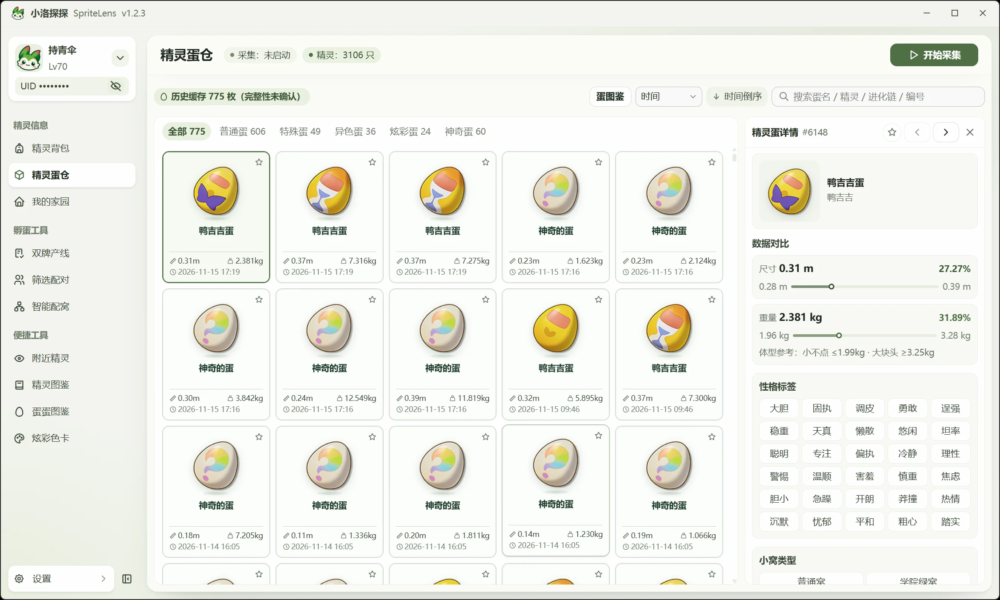

### 我的家园：居民、产蛋窝和配对关系一起看

集中查看已采集的家园居民、家具、产蛋窝、场景蛋与配对关系，并搜索居民。用于核对家里放了谁、有哪些窝、记录中有哪些配对。

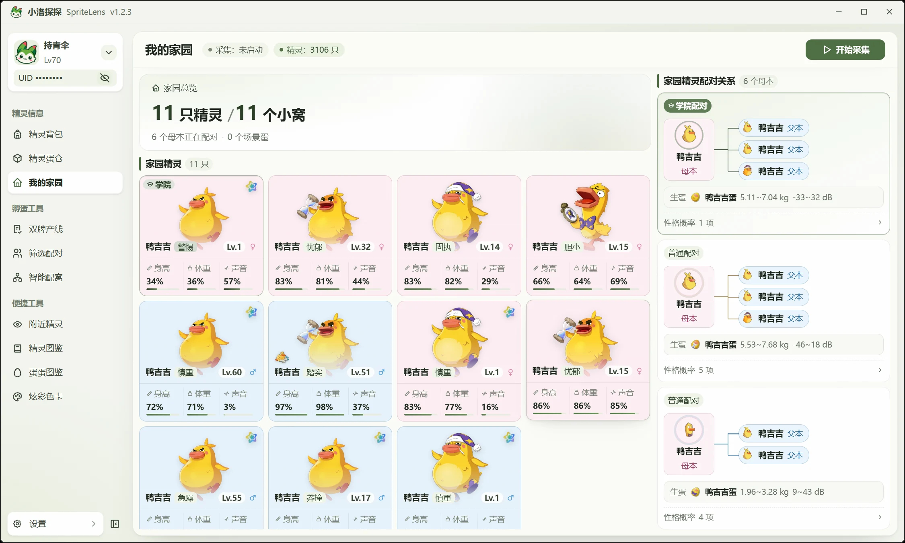

关系记录过期时，工具会依据巢穴距离、性别与蛋组提供单独标明的候选，辅助排查配对，并显示性格概率和声音均值参考。候选推断与游戏记录会区分展示，历史快照也不代表当前家园布局。

### 双牌产线：把收集目标变成一张缺口清单

按进化链整理“大块头 / 小不点”与“婉转声 / 粗嗓门”的四种组合，查看目标种母、同性格且蛋组兼容的种公，判断哪些链已有候选、哪些仍缺亲本。

可以进一步限制 **+100 / −100 dB、满体重、炫彩**，或忽略缺种公的情况。目标条件按账号保存，适合长期整理双牌收集进度。

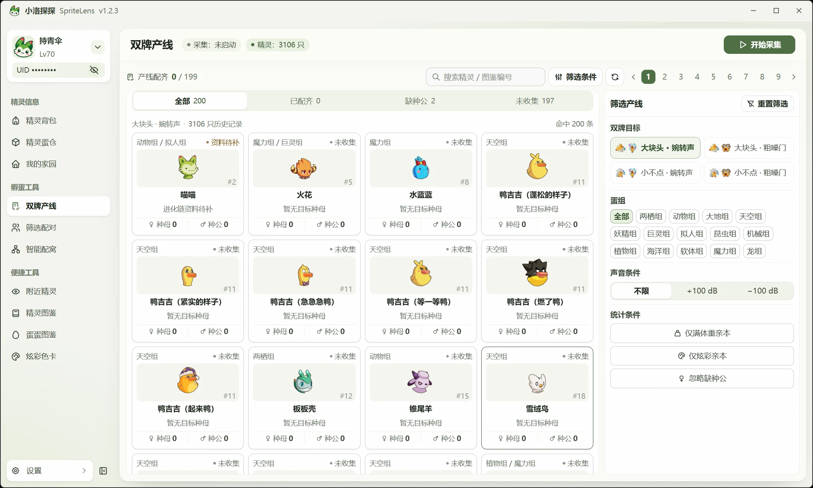

### 筛选配对：从一只亲本找到可配对象

父本与母本分两侧展示，按蛋组、性格、双牌标记、体型和声音范围缩小候选；默认要求同一性格，也可以调整。选择任意亲本后，继续筛出与它兼容的对象，两侧独立翻页。

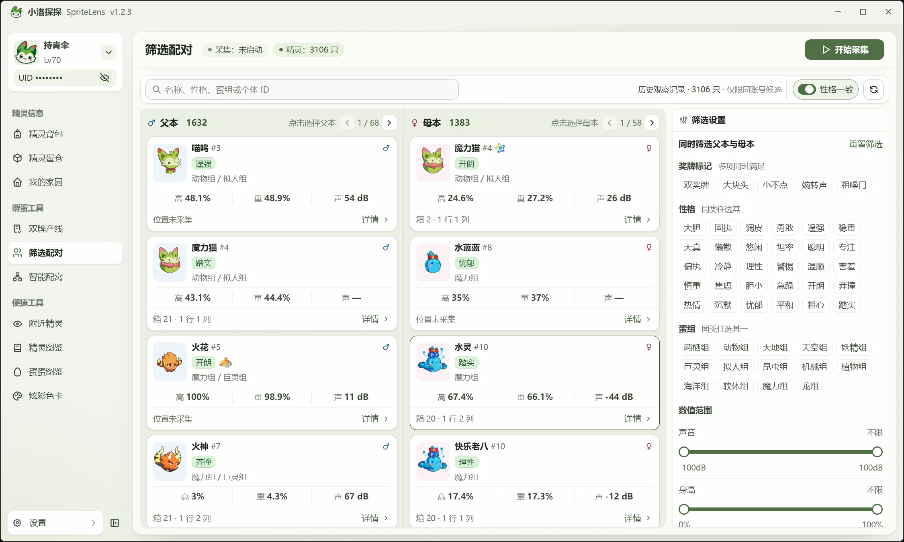

适合已经有一只好亲本、想查“库存里谁能和它配”的情况。确认后可跳回背包定位个体；兼容候选只是参考，不会替你在游戏里摆放或配对。

### 智能配窝：从想要的蛋，走到可调整的摆位方案

可以从一个或多个目标蛋出发，设置体型、声音和性格要求，反推可用亲本；也可以先自选精灵，让工具安排参与组合。

- **生成与比较**：根据当前账号库存寻找候选，查看目标支持情况、参与亲本和未用候选。
- **画布调整**：拖动摆位、锁定亲本、替换或补充亲本、换窝与撤销，修改后重新评估。
- **逐步培育**：没有直接满足目标的组合时，查看只差一类奖牌的迭代候选，决定是否继续培育。
- **保留进度**：草稿自动保存，按账号恢复；可以先规划，再回游戏照着调整。

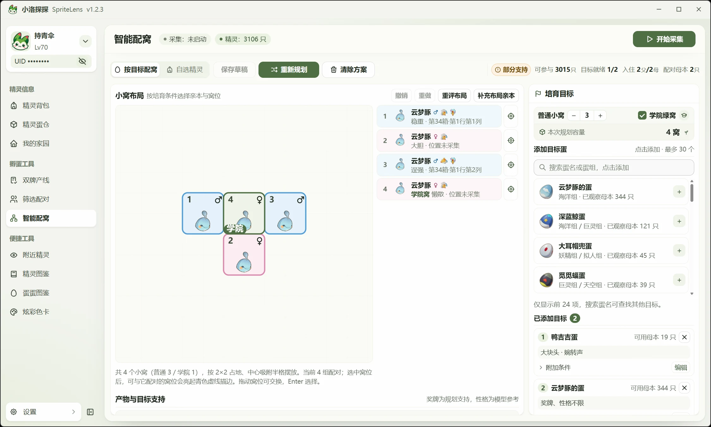

求解有候选数量和时间预算，结果是预算内找到的参考方案，不保证全局最优；没有找到方案也不证明库存绝无可用组合。画布模拟不直接读取或修改游戏内摆位。

### 炫彩色卡：查看持有情况，反查对应精灵

用“底色 × 混色”矩阵查看色卡，区分目录无此卡、尚未持有与已经持有。点开格子查看卡面、编号、配色、持有数量和关联精灵，再直接定位到背包里的对应个体。

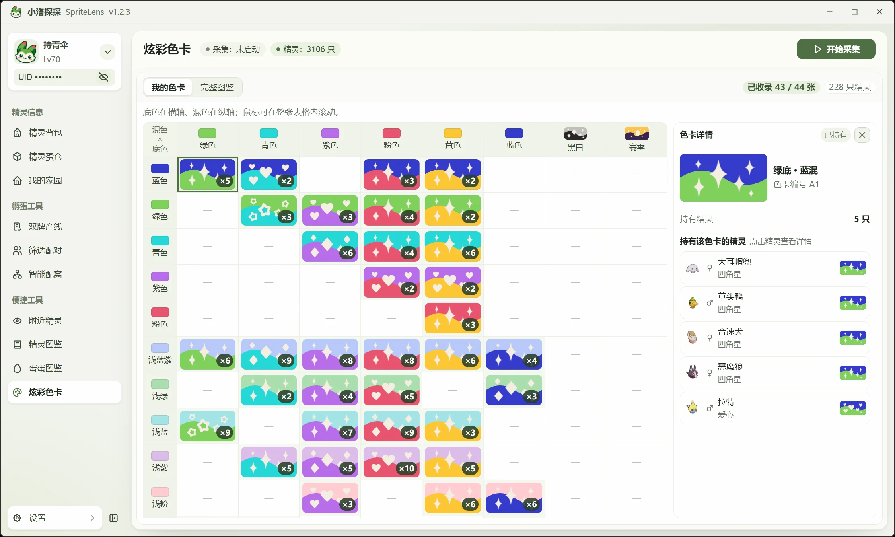

### 多账号、自动采集与本地保存

- **多账号查看**：不同连接分别采集、按账号保存；切换查看历史账号不需要切换游戏。
- **打开即采集**：按启动偏好自动开始监听；也支持游戏启动跟随，在游戏退出后结束采集。
- **离线回看**：已保存的背包、蛋仓与家园资料可以继续查看；静态图鉴不依赖游戏在线。历史资料与实时确认有不同含义。
- **本地保存**：账号资料存入 SQLite，筛选偏好、产线目标和配窝草稿留在本机，重新打开可以接着用。

### 设置与排查：先看连接状态，再按需展开诊断

设置页集中管理外观、采集网卡与端口、启动偏好、游戏跟随和录制。首次使用有引导，Npcap 缺失时提供安装入口；连接异常时可重检环境或查看高级诊断。

提供**喵喵、火花、水蓝蓝**三种浅色主题，支持调整背包显示内容、折叠侧栏；窄窗口下可用抽屉查看详情。调试预览使用独立的空数据环境，方便查看首次使用界面。

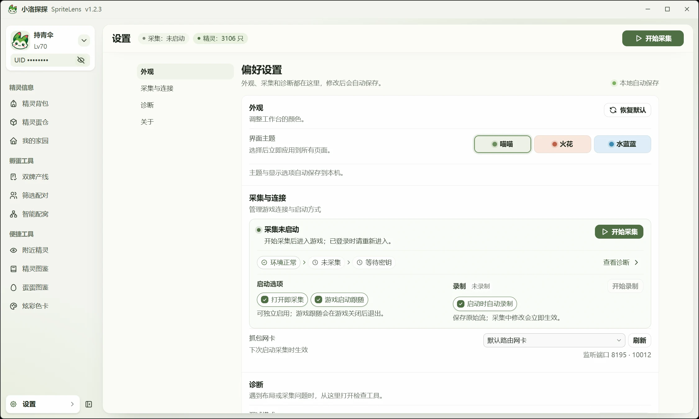

遇到难以复现的问题时，可以录制原始流并离线回放，也可结合本地事件日志排查。录制与日志可能包含会话信息，分享前需要检查内容。


## 开始使用

### 准备什么

- Windows 10/11 与游戏客户端。
- **Npcap 抓包驱动**（必需）：启动后采集页顶部会提示，按三步走即可——点「一键安装 Npcap」下载官方安装器，安装时保持默认勾选 *WinPcap Compatible Mode*，装完页面自动复检；自动下载失败时可到 [Npcap 官网](https://npcap.com/#download) 手动安装。
- 源码运行还需要 Python 3.12+、Node 24.18.1 与 npm 11.16.0（已打包程序不需要 Node）。

### 第一次运行

1. 已有程序包时直接双击 `.exe`；源码运行见下方「源码运行」。
2. 首次打开会看到使用引导，可直接跳过；之后可在设置的「关于」里重新查看。
3. 保持「打开即采集」，**先开采集、再进游戏**：会话密钥只在连接建立时下发一次，先登录后采集需要退回登录界面重进。
4. 查看顶部采集状态与精灵数量。没有同步到数据时，到设置页检查连接和诊断：没有原始流时先检查网卡与 Npcap；已有原始流但缺少密钥时，保持采集并重新登录游戏。
5. 需要钉住游戏旁边的窗口时，点附近页的「悬浮雷达」；需要提醒时打开「提醒音」（只有双牌会响）。

### 源码运行

```powershell
python -m venv .venv
.venv\Scripts\pip install -r requirements.txt

# 前端产物（首次与改前端后都要跑）
cd frontend
npm ci
cd ..
.venv\Scripts\python.exe -B tools/frontend.py build

# 启动
start.bat
```

命令行用法：

```powershell
.venv\Scripts\python.exe main.py                 # 图形界面（等价于 start.bat）
.venv\Scripts\python.exe main.py --web-browser   # 只起本地服务，用系统浏览器打开（可 DevTools）
.venv\Scripts\python.exe main.py --list-ifaces   # 列出网卡
.venv\Scripts\python.exe main.py --diagnose-net 20
.venv\Scripts\python.exe main.py --replay "%LOCALAPPDATA%\SpriteLens\recordings\capture_xxx.jsonl"
.venv\Scripts\python.exe main.py --smoke-test
```

解码字段名默认用内置最小 schema；想拿到完整字段名可运行一次
`.venv\Scripts\python.exe tools\import_schema.py`（3458 条消息定义 + 1600+ opcode 映射，未收录字段自动降级到 wire 级）。

### 打包成 exe（可选）

```powershell
.venv\Scripts\pip install -r requirements-build.txt
.venv\Scripts\python.exe build.py            # 或双击 build.bat，可选 dry-run / 改版本号
.venv\Scripts\python.exe build.py --dry-run  # 只打印命令
```

产物在 `build\小洛探探_SpriteLens_<版本>_<时间戳后四位>.exe`。打包配置（资源、排除项、输出命名）都在 `build_config.toml`。注意：部分杀软会把 Nuitka 写资源的临时文件误报并锁住，导致 `Failed to add resources`；打包前把项目目录加入白名单。`build_config.toml` 里默认的 `backend_c_flags = ["-mno-gfni"]` 用于规避部分 AMD CPU 上 Nuitka 启动崩溃，未经目标机验证不要删除。打包会复用 `build/nuitka-cache`，不要删除。

## 数据与隐私

- 运行时数据（配置、SQLite、密钥、录制、事件日志）默认在 `%LOCALAPPDATA%\SpriteLens`，可用 `SPRITELENS_DATA_ROOT` 覆盖；目录不可用会明确报错，不会悄悄切到临时目录。
- 界面由本机 HTTP 服务提供，只绑 `127.0.0.1`、端口随机、每次启动生成随机 token（经 URL fragment 交给页面，不进日志）；数据不对外发送。
- 静态资料与已有图片随包分发，可离线查看；缺失的精灵图片、账号头像或蛋图标会按需联网补图并缓存在本机。Npcap 安装也需要下载官方安装器。
- 会读取本机细节：网卡列表、游戏进程是否存在、窗口事件；不读取游戏文件内容。

**边界**：附近精灵是不完整观察，距离/方向待校准；配窝、产线与筛选配对给出的是参考规则下的候选，不代表实际配窝或遗传结果；历史缓存不当作本次实时确认。是否使用、以及在什么账号环境使用，请自行评估风险。

## 文档索引

按「先跑起来 → 查某个功能 → 改代码」排序；链接文字就是文件路径，点开即原文。

**上手与总览**

- [docs/README.md](docs/README.md) — 全部文档的阅读顺序与用途
- [docs/AI_CONTEXT.md](docs/AI_CONTEXT.md) — 项目定位、当前重点、风险区与协作入口
- [docs/CAPTURE_DIAGNOSTICS.md](docs/CAPTURE_DIAGNOSTICS.md) — 采集向导、诊断语义与排障
- [docs/NEARBY_OBSERVATIONS.md](docs/NEARBY_OBSERVATIONS.md) — 附近精灵的观察口径、已知缺口与现场校准

**功能与规格**

- [docs/EXT_API.md](docs/EXT_API.md) — 对外数据接口契约、独立 token 与安全边界
- [docs/SCENE_OBSERVATIONS.md](docs/SCENE_OBSERVATIONS.md) — 场景实体快照的协议证据与接口边界
- [docs/PROTOCOL_NOTES.md](docs/PROTOCOL_NOTES.md) — 协议观察、排障自查与未解事项
- [docs/WIKI_REFERENCE.md](docs/WIKI_REFERENCE.md) — 静态资料与 Wiki 资源导入、身份核对
- [docs/UI_GUIDE.md](docs/UI_GUIDE.md) — 前端视觉与组件规范（改 UI 前必读）
- [docs/UI_COMPONENTS.md](docs/UI_COMPONENTS.md) — 通用组件层契约与 token 速查

**开发与维护**

- [docs/DEVELOPMENT_GUIDE.md](docs/DEVELOPMENT_GUIDE.md) — 开发规范、测试取舍与任务交接模板
- [docs/ARCHITECTURE.md](docs/ARCHITECTURE.md) — 分层、协议栈与已知过渡边界
- [docs/CODEBASE_MAP.md](docs/CODEBASE_MAP.md) — 文件级代码地图
- [docs/ROADMAP.md](docs/ROADMAP.md) — 任务状态、验收条件与演进顺序
- [docs/VUE3_MIGRATION.md](docs/VUE3_MIGRATION.md) — Vue 3 演进决策与逐页迁移边界
- [docs/reviews/HEALTH_CHECK_2026-11-15.md](docs/reviews/HEALTH_CHECK_2026-11-15.md) — 最近一次全项目健康检查与清理记录

## 关于

欢迎加入 **小洛探探脑电波交流社**，交流使用体验、反馈问题与分享建议。

- QQ 群号：**1057031552**
- [小洛探探脑电波交流社](https://qm.qq.com/q/EZcOgSaMc8)

也可以扫描下方二维码加入：


