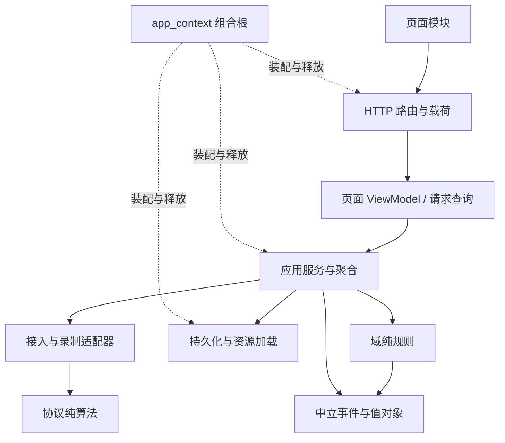

# 架构与可维护性路线图

状态：当前维护入口，2026-10-12 建立。读者：维护者、开发者与 AI 协作者。
用途：记录下一步的顺序、架构方向和验收条件；当前实现见 [ARCHITECTURE](ARCHITECTURE.md)，证据见 [项目审查](reviews/PROJECT_REVIEW_2026-10-12.md)。本文列出的代码改造均待实施。

## 当前取舍

继续使用 Python 引擎、aiohttp 本地服务、pywebview/WebView2、SQLite 和原生 JS。短期目标是守住账号归属、落盘顺序、失败恢复与页面模块边界。先修数据和生命周期，再承接智能配窝、产线收集等组合功能。

文档导航与工程规则参考本地 meow toolkit：当前入口维护事实与约束，路线图维护待办，带日期的 reviews 保存证据。避免在多个文档复制同一份任务状态。

## 阶段 0：稳定性修复（已完成，2026-10-12）

R01–R09 已全部修复并提交（0.1→0851c98、0.2→b929dce、0.3→906363e、0.3b→5e908ea、0.4→b5dbb8e、0.5→356b621、0.6→c5e9d64、0.7→06e61a6、0.8→48923c5）。每项先补确定性失败复现再修实现，复现用例已转为回归测试。

| 顺序 / 审查项 | 修复内容 | 验收结果 |
|---|---|---|
| 0.1 / R01 | 恢复判定收窄到 SQLITE_NOTADB/CORRUPT；备份失败保留原文件（WAL/SHM 一并备份） | 注入备份失败原字节不变；锁定错误不触发重建 |
| 0.2 / R02 | PetStore/EggStore 落盘锁串行化「换出→写库/回填」整段 | Event 屏障证明旧批次不覆盖新值；失败重试保留新值 |
| 0.3 / R03 | start 失败回滚 worker；stop 哨兵有界入队 + join 限时（不再以 _running 为前置） | 启动失败无遗留线程；满队列 stop 有界返回 |
| 0.3b / R09 | AppContext 持有并逆序关闭 database，单项失败不跳过其余；采集命令锁串行化 | 关闭失败仍清其余资源；并发 start 不重复建源 |
| 0.4 / R04 | Store 读取逐行隔离，坏行留定位日志、合法行照常恢复 | 混合坏行时应用可启动，坏行不被静默覆盖 |
| 0.5 / R05 | 组合根按 accounts 表统一选展示 uid；蛋仓 load_account(uid)；载荷带 uid 归属 | A/B 不同域更新顺序下宠物与蛋仓同源 |
| 0.6 / R06 | v8 迁移 egg_hatch_slots；slots 帧按 uid 落快照，恢复标记历史状态 | 重启恢复槽位；空槽快照清旧状态；切号清内存 |
| 0.7 / R07 | schema 递归显式传实例，不再读全局库 | 两实例库同字段号不同命名各自完整解码 |
| 0.8 / R08 | /api/pets 请求级 PetFilters + PetView 一次性视图，GET 无共享状态写入 | 并发 search 与 bootstrap 互不污染（回归锁定） |

## 阶段 1：依赖边界与前端模块（待实施）

## 阶段 1：依赖边界与前端模块

### 后端

- 将 `PacketEvent` 移到小型、无 IO 的中立叶子模块（建议 `spritelens/events.py`）。过渡期可从旧入口重导出，注明调用方与删除条件；同步迁移 domain 的导入，移除整个包的反向依赖豁免。
- 将 schema/opcode 的文件加载与纯解码职责明确区分。静态目录先保留现有 API，通过注入目录/目录对象降低全局缓存依赖；只有在代码修改确实涉及 loader 时再迁出 IO，不一次搬完整 domain。
- 从 CaptureViewModel 抽取采集运行服务：source 创建与生命周期、录制 tee、手动密钥和串行命令。VM 保留页面校验与展示；安装用例在实际扩展时单独抽取，采用可注入假下载/启动器。
- `LocalServer` 保留鉴权、循环与生命周期；按已有功能将路由分为 capture/pets/catalog 等模块；payloads 先按 pets 与 catalogs 拆分，并保留兼容导出。新文件必须能独立测试，避免只是转发调用。
- 聚合器一次返回包含 uid/version/数据质量的不可变快照，序列化在锁外完成。现有 `Pet` 等 frozen dataclass 可以复用，避免建立第二套同义业务模型。

目标依赖方向（待实现）：



这是依赖关系图，运行时数据可以从 capture 向上流动。组合根可以访问各层，业务模块不得反向依赖组合根。

### 前端

第一刀选独立度较高的蛋图鉴或家园页，证明抽取方式后再迁宠物页。维持原生 JS、同源静态文件和当前桌面入口。

建议目标结构：

```text
web/static/
  app.js                 启动、导航和页面协调
  api.js                 token、请求、错误与请求时序
  pages/
    egg-dex.js           该页 state/load/render/bind
    home.js
    pets.js
  pet-presentation.js    已有跨视图展示能力
  appearance.js          已有偏好状态
  ui.js                  抽屉、焦点与键盘交互
```

路径是规划，当前没有创建这些模块。抽取时用显式传入的 api、toast、导航和展示函数协作，优先沿用现有 IIFE 风格；不要依赖读取另一个页面的私有状态，也不要为几页代码先造通用 PageManager。

每页需要明确 init 一次、enter 刷新、离开后旧请求是否丢弃。订阅推送只更新当前需要的页面；所有可筛选加载都处理请求乱序，失败后保持可恢复状态。共享 escape、图片回退和展示常量，不重复复制。

验收：抽出的页有纯规则/假请求测试和 demo 交互记录；返回页面、快速筛选、请求失败、键盘关闭详情和窄窗口可用；原 API、主题和资源 URL 兼容。`app.js` 每次迁移应净减少对应页面职责，不能仅把初始化转发到新文件。

## 阶段 2：资源与发布可复现

| 任务 | 最小实施方式 | 验收 |
|---|---|---|
| 开发依赖 | 独立声明 Pillow 等工具/测试依赖，记录 Python 3.12 与已验证依赖版本 | 空虚拟环境能安装并运行完整测试 |
| 输入清单 | 工具显式接收 source，记录源 revision/version/hash | 无开发者临时目录也可运行；缺输入报明确错误 |
| 导入阶段 | 保留基础导入、补齐、媒体派生三个现有步骤，明确顺序 | 重复运行完整流水线数据不退化；中途失败不发布残缺索引 |
| 产物验证 | JSON 结构、稳定 ID、图片引用、源/输出哈希、覆盖与冲突差异报告 | 已有映射损坏可检出；未裁定冲突继续保留原值 |
| 发布清单 | 根据运行引用与派生来源关系决定包内资源 | 兜底图仍有效，调试报告/未用原图不被默认打包 |
| 持续检查 | Windows Python 3.12 的 unittest、JS语法、资源、依赖、源码smoke | 每次合并有统一结果；无需真实游戏或抓包权限 |
| 发布实机检查 | exe smoke、网卡枚举、GUI 页面启动 | 记录exe哈希/体积/依赖版本/资源版本与冷启动口径 |

保留必要原图用于重新生成派生资源，与是否放入最终包分开决定。不要以“文件看起来重复”删除 `pets/`、原头像或历史来源报告。

## 阶段 3：承接组合业务

智能配窝、产线收集应作为独立用例落在纯规则 + service + 页面。输入使用阶段1提供的账号/版本快照，不直接读各 repository 私有字段，不从 DOM 反推业务状态。

每个推断结果需要说明依据：真实采集、静态规则、历史记录或未知假设。缺图只影响展示，缺参考范围、未知账号、过期家园和不完整仓库会影响结论，必须进入计算条件与结果文案。

进入条件：阶段0修复完成；相关页面已模块化；账号、数据版本与历史状态有可查询契约；需要的协议规则已有脱敏合成样本。退出条件：规则/失败降级测试通过，载荷与页面验收完成，当前文档同步。

## 性能与健壮性验证任务

先建立可重复样本，测当前基线后再决定阈值。性能优化应与确定的瓶颈绑定。

| 场景 | 记录指标 | 需要查明 |
|---|---|---|
| 登录突发 | chunk队列字节/长度、丢弃、解码耗时、HTTP响应 | 录制与checkpoint是否拖住投递线程 |
| 慢磁盘/满磁盘 | 待写量、最后错误、退出时间 | 写失败可见，不能声明未写数据已保存 |
| 长期会话 | 流/会话数、RSS、事件日志与录制大小 | 局部上限是否构成整体预算，保留/轮转策略 |
| 长录制回放 | 内存峰值、事件数、坏行计数 | 流式读取、停止及接续验证 |
| 多连接/序号回绕 | 流键碰撞、恢复身份与丢帧 | 服务器端点隔离、32位序号语义 |
| 慢WS客户端 | 推送延迟、其它客户端响应 | 发送超时与断开是否隔离 |
| onefile启动 | 双击至可交互、解包/探测/渲染耗时 | 总耗时和排除解包耗时分别记录 |

## 每轮迭代的完成标准

1. 开始前记录工作区、假设、数据证据、范围与验证方式。
2. 用最小纵向切片实现，复用当前层次；新增抽象说明具体收益。
3. 测试覆盖改变的行为与真实风险；修复有失败复现，抽取有行为兼容检查。
4. 检查大文件增长、架构例外、资源来源与历史数据迁移；禁止静默放宽门禁。
5. 入口文档维护当前事实，路线图维护待办；历史验收记录只保存当次证据。
6. 说明已完成、未验证、遗留风险和回退条件，再更新对应任务状态。

暂缓大型技术栈替换、通用插件总线、复杂DI容器、统一万能Repository和未测量的性能优化。每个抽象至少应隔离真实外部依赖、减少重复或让具体业务更容易测试。
