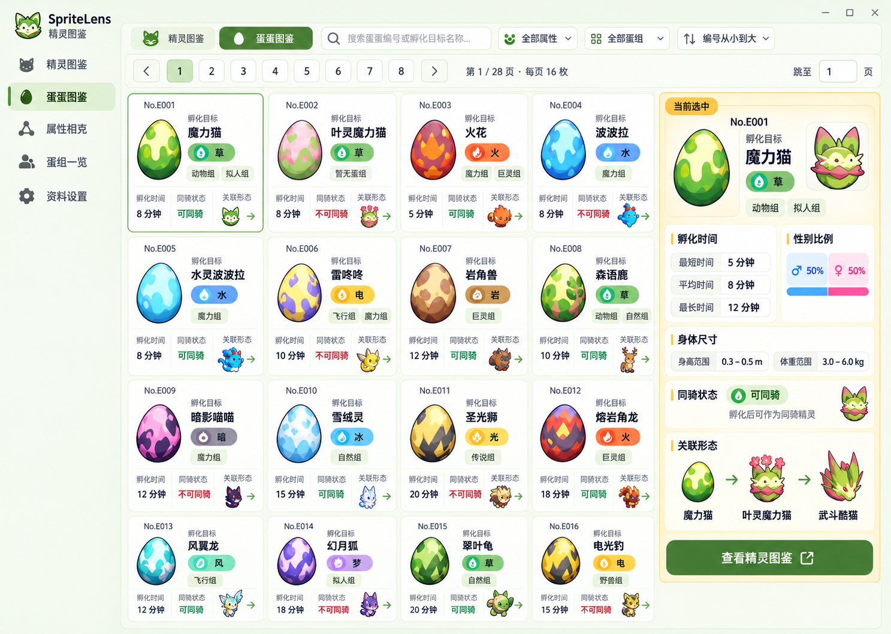

# 图鉴原型：蛋蛋图鉴

状态：已确认视觉方向的原型稿，尚未代表代码实现。  
确认日期：2026-10-21  
适用读者：产品、UI、前端与后续验收人员

## 已确认原型

本目录当前只收录已确认的图2（蛋蛋图鉴清稿）。精灵图鉴和详情/窄屏方案仍处于评审阶段，不作为实现依据。

## 页面目标

图鉴是独立的查询工具，不依赖账号内已有精灵或蛋蛋数据。软件刚打开、没有采集数据时，用户仍应能浏览、搜索和查看静态资料。

## 页面结构

- 左侧使用现有 SpriteLens 导航与页面壳层。
- 顶部工具栏承载标题、搜索、蛋组/属性筛选和分页；分页放在顶部，沿用精灵背包的操作习惯，不再把主分页放在内容底部。
- 主内容采用左侧四列蛋蛋卡片、右侧固定详情面板的双栏结构。
- 蛋蛋卡片优先展示编号、蛋图、孵化目标、属性、蛋组、孵化时长和关联形态；每块信息保持在卡片内部的固定区域，避免长文本把相邻卡片挤开。
- 详情面板展示当前选中蛋蛋的主图、基础信息、雌雄比例、体型参考、同骑信息、关联形态和跳转精灵图鉴入口。

## 内容边界

- 不展示“已收录”、账号对比、采集进度等依赖运行数据的内容。
- 不在详情中展示技能数据、描述数据和活动特殊蛋来源。
- 属性、蛋组等分类信息使用图片/图标与文字组合，不使用只有文字的属性相性列表。

## 布局验收要求

- 在设计稿对应的桌面宽度下，卡片网格、详情面板、工具栏和分页之间不得互相挤压或溢出。
- 对长名称、双蛋组、多标签、空值和最后一页少量卡片做极限测试；文字只能在明确的卡片区域内换行或省略，不能覆盖图片、标签和边界。
- 调整窗口宽度时保持主操作位置稳定；详情内容超出面板时由面板自身滚动，不推动左侧卡片网格。
- 空状态、筛选无结果和最后一页都要保留完整的工具栏与分页结构，不能产生异常空白或错位。

## 后续状态

当前仅确认蛋蛋图鉴的视觉方向。精灵图鉴主列表和响应式/详情方案待继续评审；在这些方案确认前，不将它们作为最终实现标准。
