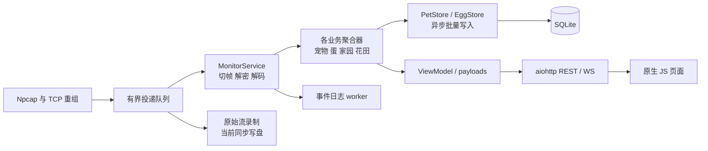

# SpriteLens 项目审查（2026-10-12）

状态：审查快照。读者：维护者及后续开发者。基线：`main` / `114be08`，审查开始时工作区干净。
本文记录证据与风险，不代表相关代码已修复。持续排期维护在 [ROADMAP](../ROADMAP.md)，开发约束维护在 [DEVELOPMENT_GUIDE](../DEVELOPMENT_GUIDE.md)。

## 1. 判断与范围

项目已经具备可以继续发展的底座：接入接口、协议解析、语义提取、内存聚合、SQLite 网关、ViewModel、本地 HTTP 与桌面壳有明确目录边界；合成协议测试、异步事件日志、数据库迁移、账号切换检测和资源映射也已建立。

当前最需要修正的是数据正确性与边界落实。后端尚未出现超大业务类，但线程生命周期、并发落盘、离线账号选择已有可复现缺陷。前端多个功能集中在 `app.js`，资源导入依赖开发者本机路径，部分文档把设计目标描述成已实现的保证。如果继续只扩功能，复杂度将主要从这些位置增长。

建议继续使用 Python + aiohttp + pywebview/WebView2 + 原生 JS + SQLite。现有证据支持先修复状态与资源所有权、按功能拆分前端、建立可执行门禁；换语言、换壳或引入复杂插件系统没有解决当前问题的直接收益。

审查覆盖源码、测试、启动与打包脚本、静态目录/schema、图片与来源报告、全部文档入口，以及本地姊妹项目 meow toolkit 的开发指南、架构上下文、路线图和可维护性计划。核心采集、持久化、账号恢复、HTTP 契约做了逐路径追踪；图片做了文件解码校验。未进行真实游戏抓包、长期挂机、GUI 视觉验收或重新编译发布 exe。

## 2. 实测基线

| 项目 | 结果 | 口径 |
|---|---:|---|
| 应用 Python | 67 文件 / 9388 行 | `spritelens/**/*.py`，含空行和注释 |
| 工具 Python | 12 文件 / 1697 行 | `tools/**/*.py` |
| 测试 Python | 32 文件 / 6020 行 | 含 `_synth.py`；31 个测试模块 |
| 最大应用 Python | `payloads.py` 659 行；`server.py` 641 行 | 路由与所有页面载荷集中 |
| 最大前端脚本 | `app.js` 2035 行 | 导航、请求、推送、各页状态与渲染 |
| 样式/骨架 | `app.css` 897 行；`index.html` 609 行 | 无前端规模门禁 |
| 最大测试文件 | `test_persistence.py` 812 行 | 已超过现有测试规模约束 |
| 静态前端目录 | 3482 文件 / 67.76 MiB | 包含图片、HTML、JS、CSS、来源记录 |
| `pet-media` | 2291 文件 / 57.24 MiB | 原图与派生图；约占前端目录 84.5% |
| 其他发布资源 | static 1.84 / schema 0.89 / resources 0.39 MiB | 发布配置整体包含这些目录 |
| 目录数据 | 1060 物种、31 性格、18 系别、1511 技能、224 种蛋 | 当前数据，而非旧导入元信息 |
| 普通头像/立绘 | 620 / 478 物种 | 按 `pet_media.json` 的 normal 映射统计 |
| 兜底精灵图/蛋图 | 829 / 223 | 与官方头像覆盖率分开统计 |
| 全量测试 | 340 项通过，7.173 秒 | 项目 `.venv` Python 3.12.10 |
| JavaScript | 8 个脚本语法检查通过 | `node --check`，不等于交互行为验收 |
| 图片 | 3436 个 PNG/WebP 解码校验通过 | Pillow `Image.verify()` |
| JSON/Markdown | 发布数据 JSON 可解析；Markdown 本地链接无缺失 | 不代表 schema、内容及反引号路径正确 |
| 源码自检/构建预演 | `--smoke-test`、`build.py --dry-run` 通过 | 自检使用隔离用户数据目录；未编译 exe |
| 环境依赖 | `pip check` 通过 | 现有虚拟环境；未验证全新环境安装 |

测试日志中坏库、迁移失败、队列满和环境探测失败是异常路径用例的预期输出。全绿只能证明现有覆盖通过，下列隔离复现显示仍有测试盲区。

## 3. 当前依赖与状态流

目录划分总体合理，但实际存在三个边界偏差：

- `domain/identity.py`、`pets.py`、`egg_box.py`、`home.py`、`flowers.py` 在运行时导入 `services.monitor_service.PacketEvent`；Monitor 又延迟导入 identity，形成依赖环。
- `domain/static_data.py`、`eggs.py`、`color_cards.py` 包含文件读取、路径与日志，`protocol/schema.py`、`opcodes.py` 包含加载 IO。文档中的“整个 domain/protocol 零 IO”并不成立，真正纯的部分是解码与提取算法。
- `CaptureViewModel` 创建抓包源、控制录制、驱动下载及安装线程。它可无 UI 测试，但已经承担应用运行时职责；后续增加能力应先拆用例，避免出现新的核心大类。

## 4. 已确认缺陷（按优先级）

P1：数据丢失、数据错属或资源泄漏，应先于下一轮复杂功能修复。P2：功能降级、契约污染或隔离性问题，纳入后续稳定性切片。复现均使用临时目录、内存库或假依赖，未触碰真实用户库与抓包环境。

### R01 / P1：坏库备份失败后删除原文件

证据：`repositories/database.py:157`，尤其 `:169–175`。`PRAGMA user_version` 读取触发 `sqlite3.DatabaseError` 后尝试重命名；备份失败进入 `unlink()`，再建空库。

复现：临时库写入无效内容，将 `Path.replace` 注入 `OSError` 后构造 Database；原内容消失，备份数为 0。这使“原数据留证”的保证失效。错误分类也未区分真正损坏与其他数据库访问异常。

修复方向：备份失败保留原文件并明确失败或使用独立临时库降级；损坏恢复应按具体 SQLite 错误分类，保留关联 WAL/SHM 的恢复策略。验收：注入备份失败后原始字节仍在，不能覆盖旧库；迁移失败仍完整回滚。

### R02 / P1：并发 flush 能让旧批次覆盖新值

证据：`repositories/pet_store.py:249`、`egg_store.py:93`。锁仅保护待写表换出，随后写数据库没有 Store 层的批次串行化。Database 锁保证单次 SQL 不交错，不能保证批次按取出顺序提交。

复现：假数据库用 `threading.Event` 挡住旧值写入；第二次 flush 提交同键新值；释放旧批次后最终值为旧值。PetStore 明确允许手动与 worker 并发；EggStore.load 的同步 flush、退出超时后的最终 flush 也提供并发入口。

修复方向：用独立 flush 互斥锁保护“换出批次→写入/失败回填”的整个顺序，或统一由唯一写者处理批次与屏障。保护待写表的锁仍保持短时间，不让 put 等待磁盘。验收：确定性屏障测试证明同键旧批次无法覆盖新值，并保留失败回填的新值优先规则。

### R03 / P1：抓包启动失败遗留投递线程

证据：`capture/npcap_source.py:86`。worker 在启动嗅探器前创建；后续抛 SourceError 时无回滚。`:144` 的 stop 在 `_running == False` 时直接返回，清不了失败启动留下的 worker。

复现：假 AsyncSniffer.start 抛异常，调用 source.stop 后 worker 仍活着并等待 queue.get。反复点击开始可累积 daemon 线程。停止路径的 `_queue.put(None)` 还可能在满队列且下游卡死时无限等，不受后续 join 的 5 秒约束。

修复方向：启动部分失败统一回滚已创建资源；stop 依据实际持有资源清理；哨兵入队和等待退出都必须有界。验收：每个启动失败点、满队列停止、重复启停之后均无遗留线程，明确超时结果。

### R04 / P1：单条格式错误的缓存数据中断整个恢复

证据：`repositories/pet_store.py:132` 的 JSON 数值转换与 `:311` 的整表对象构造；`egg_store.py:141` 起的 detail 读取也缺少结构/字段级隔离。

复现：两只合法宠物落库后，把其中一只的 attributes_json 改为 `[{"talent":"bad"}]`；PetRepository.load_last_account 抛 ValueError，其余合法宠物也无法恢复。应用装配调用恢复时未捕获此错误。蛋 detail 为合法 JSON 的列表/null、或含非数值字段，也会失败。

修复方向：逐行、逐字段验证，坏行有定位日志并隔离，保留其余合法数据；不能把所有读取错误伪装成“空账号”。验收：混合正常/坏行时应用仍能启动，合法行恢复，坏数据有证据且不会被静默覆盖。

### R05 / P1：离线恢复的宠物和蛋仓可能来自不同账号

证据：`app_context.py:111` / `:135` 分别恢复；`PetRepository.load_last_account` 按 accounts.last_seen，`EggStore.load_latest` 按 eggs.updated_at 独立选账号。

复现：A 有蛋；B 最后登录并写入 accounts，但没有更新蛋仓。重启恢复时宠物归属 B（示例 uid 22），蛋仓归属 A（uid 11），页面未提供对应蛋仓身份标记。

修复方向：组合根统一选一个展示账号，各域按同一 uid 恢复；该账号无蛋记录时展示未知/空缓存并说明，不能拿其他账号补齐。验收：A/B 不同域更新顺序、无蛋账号、首次离线与同账号重新登录均保持统一归属。

### R06 / P2：孵化槽状态未持久化

证据：`services/egg_repository.py:50–59`。slots 帧更新 `_hatch_slots`，随后把未经变换的 EggBoxEntry 写入；Store 的 hatching 来自 entry.hatching，与 slots 无关。恢复时也不重建槽位。

复现：蛋条目的时间字段为 0，再收到槽位 `[9001]`；实时 payload 识别为孵化中，重新读取 Store 的条目 hatching 为 False，槽位映射丢失。

修复方向：按账号保存独立孵化槽快照及采集时间，恢复标记为历史状态；不要把缺失槽位事件推断为未孵化。验收：仅由 slots 驱动的状态重启可恢复，退出孵化、切号和新空槽快照可清旧状态。

### R07 / P2：注入 schema 实例仍依赖全局库解码子消息

证据：`protocol/schema.py:49–66`。SchemaLibrary.decode 使用当前实例的根定义，递归 `_field_to_dict` 从 `get_library()` 取子定义。

复现：创建 Root→Child 实例库，全局库设为空；解码 `0a020807`，根字段命名正确，Child.value 变成 field_1。多个测试库或未来按游戏版本选择库会相互影响。

修复方向：递归显式传当前库/字段解析函数，加载入口与纯解码分开。验收：两个独立库相同字段号不同命名时，各自完整解码且不受加载顺序影响。

### R08 / P2：HTTP 查询修改共享页面状态

证据：`web/server.py:335` 修改 ctx.pet_vm；bootstrap 在 `:300` 直接消费该 VM。`app.js:229` 的概览刷新还请求无条件 `/api/pets`，会重置同一 VM 筛选。

复现：同一 context 两只宠物，请求 search=A 后再 bootstrap；total=2，但 bootstrap 仅给出 A。浏览器刷新时前端筛选控件按初始空条件建立，返回数据却继承上一个请求筛选。多个本地客户端也互相影响。

修复方向：请求解析成不可变查询对象，将查询参数与数据快照一起传入筛选函数；GET 不改全局 VM。验收：请求顺序、bootstrap 与两个客户端查询互不污染；保留目前 pets 请求序号防止旧响应覆盖新结果的行为。

## 5. 需要治理的结构风险

### R09：运行时所有权与并发命令没有收口

`AppContext` 创建 Database 却不持有或关闭它；close 提前置 `_closed=True`，前一项清理异常会跳过后续资源，也不能再次补清理。build 中途失败没有已创建资源的回滚。应建立显式资源所有权和逆序清理，逐项尝试并汇总失败；可以使用标准库 ExitStack/try-finally，暂不需要生命周期框架。

capture start/stop 等命令在 aiohttp 中经 to_thread 调用，但 CaptureViewModel 的“是否正在运行/安装→执行”没有锁或串行队列。同一来源的多个 HTTP 请求可并发创建来源或操作录制；这属于代码可见的竞态风险，本轮没有把它表述为已经实机出现。应在运行服务串行化副作用命令，快照通过短锁获取，锁内不做等待和磁盘 IO。

HTTP 命令输入也未统一校验：`server.py:492` 把无效JSON和非对象降为`{}`，`:462` / `:469` 用`bool(enabled)`，因此字符串`"false"`会变成True，空体会被当作False且返回成功。应沿用偏好接口的严格输入错误反馈，明确400与副作用失败语义；这些路径需要请求级回归测试。

`LocalServer.start` 超时未回收后台启动，`_start_async` 失败时 runner 可能未清理，广播依次等待每个 socket 且未设发送超时。各项需要故障注入后再确定修复范围，避免直接大改服务循环。

### R10：旁路仍会阻塞采集，资源边界与数据完整性脱节

`CaptureViewModel._tee_chunk` 先调用 StreamRecorder.append，后调用 monitor；recorder 每段同步 write+flush。Monitor 在自身锁内同步保存 session checkpoint，且串行调用所有 listener。因此启用录制或慢磁盘时，投递线程仍可能停顿。事件日志已经采用唯一 worker、有界队列和失败计数，是可参考的实现。

Npcap 队列满会丢 chunk，但未通知 FrameStream/业务快照“该流存在缺口”；后续 magic 同步可以恢复一些帧，不能证明账户/仓库状态完整。当前只显示丢弃统计，后续应增加流级质量状态，把相关快照标记为待补全，直到可靠全量数据重新确认。

Monitor 256 个会话、单重组器 pending 8 MiB、事件 2000 条等都是局部限制。capture 流表没有数量硬上限，队列按条数而非字节限制，decoded 对象大小也不同；不能把这些数值解释为整体内存有界。回放 read_recording 还一次读入整文件并解 hex。先测登录突发和长录制，再设总字节预算与流式回放，不凭感觉添加阈值。

流 ID 当前只有客户端 IP:port，未含服务器端点；多连接/附加端口下有碰撞风险。TCP 序号和会话接续只作普通整数比较，对 32 位回绕的处理需专项样本测试。此两项列为验证任务，未声称当前登录必然失败。

### R11：快照与协议证据需要明确语义

PetRepository 和 EggBoxRepository 主要按 ID 累积/upsert，不能证明服务器快照之外的旧条目已经删除。没有完整分页和删除协议证据前，应明确“历史观察集合”与“当前完整仓库”的区别。新增配窝和产线推断必须显式处理历史、未采集、数据缺口、账号切换与版本变化。

宠物载荷分别读取 filtered_pets、all_pets、backpack、location、version；各读取有锁，但整个响应不属于同一版本。抓包更新时可能组合旧条目与新位置/版本。应一次获得带 uid/version 的不可变业务快照，再在锁外筛选与序列化；多个业务域之间也应携带账号标记以便前端拒绝旧账号响应。

零值与缺失值混用（例如 voice=0 被展示为暂无数据），部分业务仍依赖 schema 名称寻找节点。后续每次适配要登记：字段号、单位、来源样本、零值含义、全量/增量语义和失败降级。不能仅因“形状搜索”就声明所有字段能抗 schema 漂移。

### R12：前端增长点缺乏自动约束与行为测试

`app.js` 已集中过多页面，`server.py` 和 `payloads.py` 正在向同一路径增长。现有 guide 的“新增页直接改 app.js/server.py/payloads.py”与规模控制冲突。小辅助脚本虽然分出图片和筛选，主状态、加载与渲染仍在同一闭包，压缩成单行也不能降低职责复杂度。

建议按页面抽出 state/load/render/bind，将 api、escape、请求时序与推送留为少量共享能力。已有宠物 loadPets 有 requestId 保护，应作为其他可筛选页面的行为标准；图鉴和蛋图鉴尚无相同保护。启动重试包含初始化与绑定事件，若后半段失败再执行会重复绑定；应拆开“可重试取数”与“一次性初始化”。

现有测试主要验证 Python 载荷、资源映射与源码文本，8 个 JS 语法全绿不能证明筛选、快捷条件、焦点返回、重试和请求乱序正确。下一步补少量原生 Node 纯规则/假请求测试，以及独立 demo 的关键交互验收；无需为了这些测试先更换 UI 框架。

### R13：资源导入不可完整复现，发布体积记录过期

已具备的能力应保留：稳定 ID 联查、官方镜像哈希、源冲突保留、缺图降级、normal/shiny 映射、原图和派生图区分、Tabler MIT 来源。现有 856 条数据冲突是未裁定的来源差异，不能自动按最新版本覆盖。

仍需解决：

- `import_egg_data.py` / `import_pet_details.py` 默认读取开发者临时目录；schema 下载使用远端 main，没有源 revision/hash 锁定。
- `requirements.txt` 和 build 依赖仅设下界；测试与资源工具使用 Pillow，但依赖文件没有声明开发依赖。当前 venv 可用不代表新机器能复现测试。
- `import_static_data.py:172` 直接整表覆写 species 等文件，之后 enrichment 的45个新增物种、范围、描述等需要重新叠加；README“脚本幂等”不代表多阶段流水线安全或不会退化。
- sync 工具直接写正式目录/映射，失败可留下部分批次；sync_pet_media 对已存在文件直接信任，来源哈希不等于转码后文件哈希；mirrorPath 未做与 catalog sync 一致的根路径校验。
- `_assets_meta.json` 含本机绝对路径；旧 `_meta` 的1015物种/1378技能与当前1060/1511不同。应标记阶段来源统计，另给当前汇总，避免混读。
- `README` 的约22MB、架构决策中的22.3/26.4MB与当前发布资源约70.89MiB不是同一口径。源资源大小不能推出最终压缩 exe 大小；必须重建后记录实测体积、冷启动及解包成本。
- Nuitka 整目录打包所有原图、派生图与报告。`pets/` 仍有明确兜底调用，`pet-media` 原图还是派生来源；应先形成引用/来源图与发布白名单，再决定哪些开发原图/报告可留在仓库且不入发布包。

推荐流程：明确输入与版本→临时输出→格式/引用/图片/覆盖率/冲突验证→差异预览→整批发布映射。先给现有工具补参数与报告规则，不创建通用资产平台。

### R14：文档与门禁对实际实现描述过强

当前 Markdown 超链接检查无缺失，但反引号命令和架构宣称仍有漂移：README 的两个 sync 示例缺必需的 source 参数；开发指南说 ES5 风格却实际使用 Promise、fetch、Map/Set、const 等现代能力；图标已用本地 sprite，旧指南还引导内联 SVG。

`test_architecture.py:35` 为整个 domain→services 包放行，文件头仅声称 identity/pets 类型例外，实际至少5个域模块已经使用。相对导入只收集为点号字符串，后续 startswith 判断会跳过，未真正拒绝；根级模块及若干同层依赖也不受完整检查。禁止网络/线程 import 不能证明没有 pathlib.read_text IO。应改成明确允许依赖表，解析相对导入，例外精确到模块/符号，并分别测试純规则与资源加载。

仓库没有 `.github` 工作流，构建入口也未串接测试门禁。流程目前依赖人工记忆。优先建立 Windows Python 3.12 的全量 unittest、资源校验、JS 语法、源码 smoke 与依赖检查；源码 CI、真实驱动验收、打包 GUI 验收应分别报告。

## 6. 可持续迭代框架

参照 meow toolkit 的组织方式，保留其“快速上下文→当前指南→架构→路线图→专题/历史证据”的导航。采用其复杂文件约束、按风险选测试和临时代码删除条件，并扩展到原生 Web 前端与资源流水线。

每项功能按一个可验证的纵向切片交付：协议/静态数据证据→纯规则→业务服务或聚合→持久化→载荷契约→页面→异常与验收。无需每次涉及所有层；每层只修改该用例必要部分。

新切片开始前写清楚五件事：数据来源及未知项；读写/线程所有者；影响哪些当前契约；怎样复现失败和确认成功；如何回退代码且不破坏用户数据。修复先补能暴露问题的行为测试，抽取时保留原调用入口直到所有调用方迁移完成。

| 边界 | 应承担 | 完成标准 |
|---|---|---|
| 协议算法/域规则 | bytes/字段树到对象、筛选与推断 | 不启动 HTTP/窗口/真实驱动可测 |
| 应用服务 | 采集命令、账号归属、用例与运行状态 | 副作用有唯一所有者，失败/停止可验证 |
| Repository/资源加载 | SQL、JSON、静态目录与版本 | 迁移/坏数据/慢盘不静默丢值 |
| ViewModel | 页面命令校验、展示状态 | 不构造设备、下载线程或写 SQL |
| HTTP/载荷 | 鉴权、请求校验、快照到 JSON | GET 无共享筛选副作用，响应对应单一账号/版本 |
| 页面模块 | 该页状态、DOM、绑定与请求 | 初始化幂等，旧响应不能覆盖新状态 |
| 工具/发布 | 输入输出、验证、资源打包 | 新环境可运行，来源和产物可追溯 |

工程门禁应保护行为与边界，不能只考核行数和测试数量。每次改动检查：热点文件是否增长、依赖是否反向、读模型是否一致、失败是否可观测、文档是否仍讲当前事实。落地次序与逐步验收见 [ROADMAP](../ROADMAP.md)。

## 7. 本轮交付边界

本轮交付审查报告、架构路线图、协作入口和开发约束更新。运行代码、数据和图片没有修复或迁移，R01–R08 均仍待处理。没有重新编译 exe，因此不能据本轮源码验证宣称发布产物已可靠；没有游戏在线样本与视觉验收，因此不能确认完整实时仓库语义或全部页面交互。
